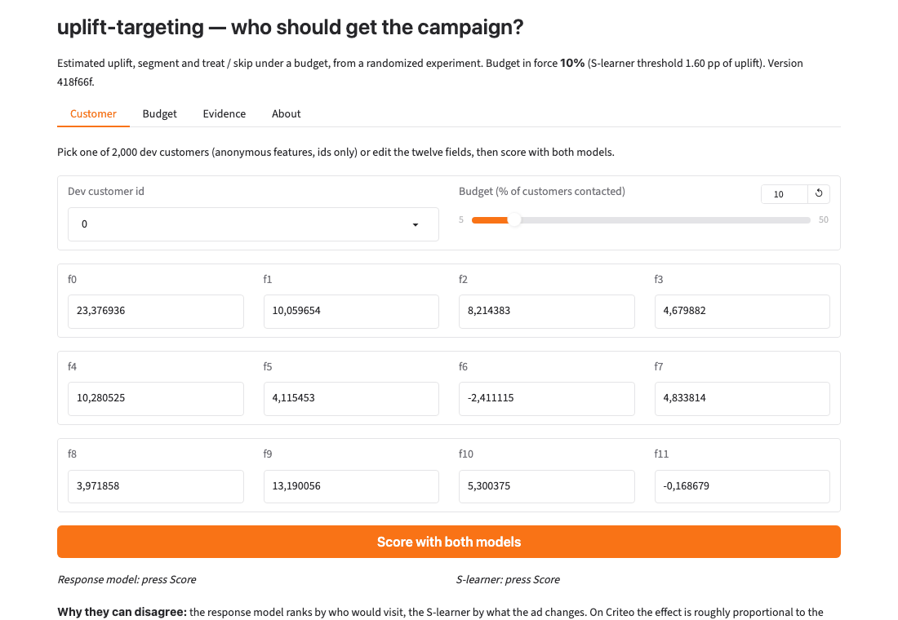

# uplift-targeting

[](https://davutkursun-uplift-targeting.hf.space/ui)
[](https://github.com/DavutKursun/uplift-targeting/actions/workflows/ci.yml)

**Decides who should receive a marketing campaign by the effect it has on them, not by how likely they are to buy anyway.**



Live demo: **https://davutkursun-uplift-targeting.hf.space/ui** · API docs at `/docs` · a customer's uplift, segment and
treat / skip decision in about a millisecond of model time.

## The problem
A campaign budget covers a fraction of the customers. Targeting the people most likely to convert wastes the
budget on those who would have converted without the offer, and can even hurt by contacting people the offer
annoys. The right question is causal: whose behaviour does the offer change?

## Results (test split, 800,004 customers, used once on 2026-10-28)

**At a 10% budget, targeting on uplift finds 62.9 incremental visits per 1,000 contacts; targeting on response
probability finds 49.0; random targeting finds 9.0.** The uplift-minus-response difference is
+13.9 per 1,000 with a paired-bootstrap 95% CI of [6.5, 21.6], which excludes zero.

| Budget | random | response model | S-learner (deployed) | S − response, paired 95% CI |
|---|---|---|---|---|
| 10% | 9.0 | 49.0 | 62.9 | +13.9 [6.5, 21.6] |
| 20% | 9.9 | 39.2 | 38.9 | −0.4 [−2.5, 2.1] |
| 30% | 11.3 | 29.4 | 28.4 | −0.9 [−2.2, 0.2] |

Incremental visits per 1,000 contacts, i.e. the visit rate of the treated minus the control customers inside the
targeted set, which the randomised assignment makes unbiased. Normalised Qini on test: S-learner 0.085 [0.075, 0.096], response
model 0.085 [0.074, 0.096], paired difference −0.000 [−0.005, 0.007]. Placebo (treatment shuffled before training): Qini −0.002 [−0.014, 0.010] on dev and −0.016 [−0.029, −0.002] on test for one shuffle of the training labels, negative rather than zero, so not leakage; a single shuffle is a noisier null than its CI suggests: six shuffles on dev span −0.073 to +0.027, and the deployed model's 0.085 lies far outside that spread (`docs/DESIGN.md` §5.6).

**Profit guidance, under stated assumptions** (value 2.00 per incremental visit, cost 0.10 per contact; only the
ratio matters): contact the top 5–6% of customers by predicted uplift and stop by 13–14%; at that budget the
uplift model earns 3.6 per 1,000 customers against 0.7 for the response model's best budget;
**at 20% every policy loses money**, and random targeting loses at every budget.

### Response vs uplift: when it matters

| Situation | What the numbers say | Use |
|---|---|---|
| Tight budget (≤ 10% of customers) | +13.9 visits per 1,000 contacts for uplift over response, CI excludes 0; profit-maximising budgets sit here | **the uplift model** |
| Wide budget (≥ 30%), or an effect proportional to the base rate (as here: +27% in every slice) | the two rank the same customers; the paired difference is inside its CI | the response model is enough |
| Rare outcome (`conversion`, 0.3% base rate) | Qini 0.218 [0.157, 0.282] vs 0.215 [0.156, 0.275], paired difference +0.003 [−0.006, 0.016]: the CIs are the result | nothing separates them — say so, use the simpler model, get a bigger holdout |
| A world with sure things and sleeping dogs (synthetic, known truth) | the response model ranks sure things first: Spearman −0.08 with the true effect, 6 incremental visits per 1,000 at 20% against 21 for random and 50 for the S-learner | uplift learning is necessary; **the response model is worse than random** |

### Honest notes
- **The randomisation is imperfect.** Treatment is weakly predictable from the features (AUC 0.51, max |SMD| 0.05) and
  every covariate adjustment lowers the visit ATE from 1.03 to about 0.8 pp. All numbers above are the raw
  treated-minus-control estimates, as in the dataset paper; IPW-weighted versions (cross-fitted propensity) are in
  `docs/DESIGN.md` §4–5 and run about a quarter lower from the 20% budget upward, without changing any ranking.
- **Sleeping dogs are not demonstrated.** The customers the model flags as harmed by contact (0.2% of test) show an
  observed uplift of +0.1 pp [−6.8, 7.0] on dev and **+10.1 pp [3.4, 16.9] on test**, helped rather than hurt; the wider
  group with any negative prediction (6.6%) shows +0.3 pp [−0.1, 0.7]. Nothing in this data says the ad hurts anyone.
  The segment label is shown, and acted on only as "no predicted gain".
- **Features are anonymous** (Criteo's f0–f11), so the product can say *that* a customer is persuadable, not why.
- **Data licence:** CC BY-NC-SA 4.0, non-commercial; cite Diemert et al., AdKDD 2018. The raw file is not in this repo.

- **Tuning optimism.** The three learners whose settings were chosen on dev lost about 0.008 of Qini from dev to test,
  the untuned ones 0.002–0.005; on test the response model ties the deployed model on Qini. The headline 10% difference is
  the number that replicated (+13.0 on dev, +13.9 on test); the dev advantages at 20% and in Qini did not.

Every number, its dev counterpart and the scripts that produced it: `docs/DESIGN.md`; model card: `docs/model_card.md`.

## Use it

```bash
# one customer: the twelve anonymous Criteo features; extra or missing fields are rejected (422)
curl -s -X POST "https://davutkursun-uplift-targeting.hf.space/score?model=s_learner&budget=0.10" \
  -H "content-type: application/json" \
  -d '{"f0": 23.3769, "f1": 10.0597, "f2": 8.2144, "f3": 4.6799, "f4": 10.2805, "f5": 4.1155, "f6": -2.4111, "f7": 4.8338, "f8": 3.9719, "f9": 13.1901, "f10": 5.3004, "f11": -0.1687}'
# → {"uplift": -2e-06, "p_control": 0.00076, "p_treated": 0.000757, "segment": "lost_cause", "segment_note": null, "decision": "skip", "budget": 0.1, "threshold": 0.0159899, "outcome": "visit", "model": "s_learner", "version": "418f66f", "latency_ms": 1.63}
#   (dev customer 0: a lost cause — a 0.08% visit probability that the ad does not move; skip at any budget)

# the policy at a budget: threshold, expected incremental visits per 1,000 contacts (dev, raw and IPW), profit, break-even
curl -s "https://davutkursun-uplift-targeting.hf.space/policy?budget=0.10"
```

`POST /score/batch` takes up to 1,000 customers; `?model=r_learner` scores with the cross-check learner; `GET /health`.
The segment `no_detectable_effect` is the textbook sleeping dog, renamed because held-out data did not confirm any harm;
every response carrying it also carries that sentence. Requests are logged without feature values; nothing is stored.

**Latency.** Live Space (cpu-basic), 30 calls from a laptop: round-trip p50 164 ms / p95 183 ms for the S-learner and 163 / 191 ms for the R-learner, of which about 1 ms is model time (`latency_ms` in the response); locally over HTTP the p50 is 1.1 ms and 1,000 customers score in 29 ms (`eval/results/latency_space.json`, `latency_local.json`; target p50 < 30 ms of model time, met).

Run it locally: `make serving app` then open http://127.0.0.1:7860/ui, or `docker build -t uplift . && docker run -p 7860:7860 uplift`.

## What this does
- Estimates each customer's uplift (treated minus untreated outcome probability) with seven learners, from the
  naive response model to cross-fitted R- and DR-learners, on randomized-experiment data
- Validates every learner against a synthetic world where the true effects are known
- Measures on the holdout what a randomized experiment allows: Qini, observed uplift by decile, incremental
  outcomes per 1,000 contacts at each budget, with bootstrap confidence intervals, paired differences and a placebo
- Turns the score into a decision: budget → threshold → treat / skip, profit under stated economics, and the
  persuadable / sure thing / lost cause / sleeping dog segment

## Data
Criteo Uplift Prediction Dataset v2.1 (≈ 14M rows, randomized treatment, 85% treated; outcomes `visit` and
`conversion`). Stratified random splits 60/20/20; a 4M-row working subsample by default.
Licence: the data is released by Criteo AI Lab under CC BY-NC-SA 4.0 (non-commercial, attribution, share-alike);
cite Diemert et al., "A Large Scale Benchmark for Uplift Modeling", AdKDD 2018. The raw file is not in this repo.

## Run it yourself
```bash
pip install -r requirements-dev.txt && pytest -q      # no data needed
python scripts/download.py                            # where to put the raw file
make splits ate synth train eval-dev policy-dev paired-dev placebo plots-dev
make serving bench api-test                           # the dev policy grid for the service, the latency benchmark, the API tests
```
